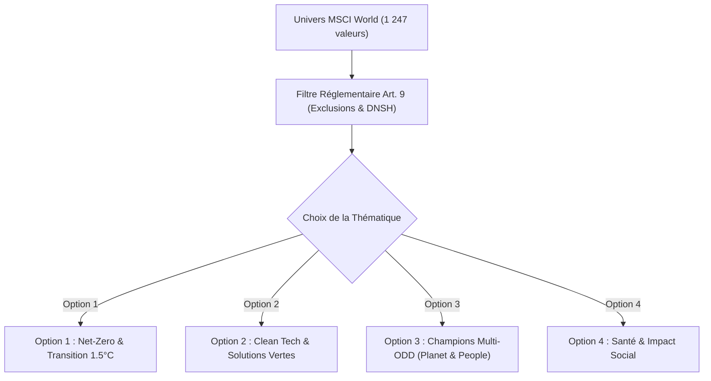

# Critères d'Éligibilité d'une Entreprise pour un Fonds Article 9 SFDR
*Projet Final Finance Durable – Université Paris-Dauphine (M2 272)*  
*Enseignants : Thierry BÉCHU & Jean JARDEL (Kanopy AM)*

---

## 1. Cadre Réglementaire : L'Article 9 SFDR et l'Investissement Durable

Dans le cadre du règlement européen **SFDR (Sustainable Finance Disclosure Regulation - UE 2019/2088)**, un fonds **Article 9** (souvent qualifié de fonds « *vert foncé* » ou *dark green*) a pour objectif explicite **l'investissement durable**. 

Selon l'**Article 2(17) de la SFDR**, la quasi-totalité des actifs du portefeuille (hors trésorerie et instruments de couverture) doit obligatoirement être constituée d'entreprises respectant **trois critères cumulatifs** :

### A. Contribution positive à un objectif environnemental ou social
L'activité économique de l'entreprise doit contribuer activement et de manière mesurable à :
* **Un objectif environnemental** :
  * Part de chiffre d’affaires alignée avec la **Taxonomie européenne** ou issue des technologies propres (*Clean Tech*).
  * Trajectoire de transition climatique alignée avec les Accords de Paris (hausse de température implicite **ITR $\le 1{,}5^\circ\text{C}$ ou $2^\circ\text{C}$** et réduction des émissions Scopes 1, 2 et 3).
* **Un objectif social ou sociétal** :
  * Contribution nette positive à un ou plusieurs des 17 **Objectifs de Développement Durable (ODD / SDG)** de l'ONU (lutte contre la pauvreté, accès à l'eau, santé, égalité des genres, etc.).

### B. Le principe DNSH (*Do No Significant Harm* / Ne Pas Causer de Préjudice Important)
Une entreprise qui contribue positivement à un objectif durable ne doit pas en détruire un autre :
* Prise en compte et suivi des **PAI** (*Principal Adverse Impacts* / Principales Incidences Négatives).
* **Absence de controverses sévères** sur le plan environnemental ou social (violations des droits humains, pollutions majeures, atteintes à la biodiversité).

### C. Pratiques de bonne gouvernance (*Good Governance*)
L'entreprise doit démontrer des pratiques saines et éthiques de gouvernance :
* Respect des droits du travail et relations avec les salariés.
* Structures de gestion transparentes et équité des rémunérations.
* Respect des obligations fiscales et lutte contre la corruption.
* Absence de controverses graves sur la gouvernance et notation minimale requise.

---

## 2. Exclusions Normatives et Sectorielles Obligatoires

Pour être conforme aux exigences de l'Article 9 ainsi qu'aux standards de référence européens (PAB - *Paris-Aligned Benchmark*) :

1. **Armes controversées** : Exclusion stricte à $0\%$ (mines antipersonnel, bombes à sous-munitions, armes chimiques ou biologiques).
2. **Tabac** : Exclusion totale des producteurs de tabac.
3. **Charbon thermique et énergies fossiles non conventionnelles** :
   * Exclusion des entreprises générant plus de $1\%$ de leur chiffre d'affaires à partir de l'extraction de charbon thermique.
   * Exclusion des entreprises générant plus de $10\%$ de leur chiffre d'affaires à partir de la production d'électricité issue du charbon thermique.
   * Exclusion des exploitants de sables bitumineux, pétrole de schiste et forages en Arctique.
4. **Violations des normes internationales** : Exclusion des entreprises en infraction caractérisée avec le **Pacte Mondial des Nations Unies (UNGC)** ou les principes directeurs de l'OCDE.

---

## 3. Critères Réglementaires Spécifiques pour un Fonds de Droit Français (AMF DOC-2020-03)

L'**Autorité des Marchés Financiers (AMF)** encadre strictement la communication et les allégations extra-financières des fonds français :

* **Taux de sélectivité minimal de 20%** : Le processus d'investissement doit conduire à exclure au moins $20\%$ des valeurs les moins vertueuses de l'univers de départ (MSCI World Developed Markets).
* **Approche en engagement significatif** : Les critères extra-financiers doivent avoir un impact réel et vérifiable sur l'allocation d'actifs.
* **Mesurabilité et reporting d'impact** : Le fonds doit définir des indicateurs de suivi (KPIs) mesurables (ex. intensité carbone globale, taux d'alignement taxonomie, score ESG moyen pondéré) et démontrer une surperformance par rapport à l'univers d'investissement initial.
* **Quota d'investissements durables** : Engagement formel sur une part minimale très élevée (souvent $\ge 90\%$) d'investissements répondant à l'article 2(17) SFDR.

---

## 4. Traduction Opérationnelle dans le Dataset `all_data.csv`

Voici la correspondance directe entre ces critères et les 100 variables fournies dans le fichier de données :

| Exigence Réglementaire | Variables clés dans `all_data.csv` | Filtre Opérationnel Recommandé |
| :--- | :--- | :--- |
| **Exclusion Armes controversées** | `CWEAP_TIE` | Exclure si `CWEAP_TIE == 1` |
| **Exclusion Tabac** | `TOB_PRODUCER` | Exclure si `TOB_PRODUCER == 1` |
| **Exclusion Charbon / Énergies fossiles** | `gics_sector_name`, `INTENSITY_SCOPE_1`, `2`, `3` | Exclusion sectorielle ciblée / seuil d'intensité carbone |
| **DNSH & Controverses** | `ENVIRONMENT_CONTROVERSY_SCORE` `SOCIAL_CONTROVERSY_SCORE` `GOVERNANCE_CONTROVERSY_SCORE` | Éliminer les entreprises avec des scores de controverse faibles (niveaux sévères / critiques) |
| **Bonne Gouvernance** | `GOVERNANCE_PILLAR_SCORE` `GOVERNANCE_CONTROVERSY_SCORE` | Exiger un score minimum de pilier gouvernance |
| **Sélectivité ESG globale (Règle AMF -20%)** | `IVA_COMPANY_RATING` `CBN_LCT_SCORE` | Exclure les moins bonnes notations (ex. `CCC`, `B`) pour respecter les $20\%$ de réduction minimale |
| **Contribution positive (Climat / Taxonomie)** | `EST_EU_TAXONOMY_MAX_REV` `CT_TOTAL_MAX_REV` `ITR` (Implied Temperature Rise) | Exiger un ITR $\le 2^\circ\text{C}$ (ou $\le 1{,}5^\circ\text{C}$) et/ou un seuil de CA vert / Clean Tech |
| **Contribution positive (ODD / Social)** | `SDG_01_NET_ALIGNMENT_SCORE` à `SDG_17_NET_ALIGNMENT_SCORE` | Sélectionner les entreprises avec un alignement positif net sur l'ODD ciblé |

---

## 5. Prochaines Étapes pour la Construction du Portefeuille

1. **Fixer la thèse et l'objectif durable du fonds** (ex. Décarbonation & Climat Net-Zero, Transition Énergétique & Clean Tech, ou Multi-Thématique ODD).
2. **Appliquer l'entonnoir de filtrage (Filtration Funnel)** :
   - Univers initial : 1247 valeurs du MSCI World Developed Markets.
   - Étape 1 : Exclusions normatives & sectorielles (Armes, Tabac, Charbon).
   - Étape 2 : Filtres ESG & DNSH / Gouvernance.
   - Étape 3 : Filtre de contribution positive spécifique à la thématique retenue.
   - Étape 4 : Filtres financiers (santé financière, rentabilité, volatilité, Sharpe).
3. **Optimiser l'allocation et la pondération** (Equipondéré, Min-Variance, Max-Sharpe, ou pondéré par le score durable).
4. **Vérifier les contraintes AMF et la surperformance extra-financière**.

---

## 6. Détail du Point 1 : Choisir la Thématique & l'Objectif Durable du Fonds

### Pourquoi ce choix est-il capital pour l'Article 9 et pour votre soutenance ?

1. **Exigence réglementaire SFDR** : Un fonds Article 9 ne peut pas avoir un objectif flou ou généraliste (du type *« fonds d'actions éthiques »* ou *« approche ESG généraliste »*, qui relèvent de l'Article 8). Il doit obligatoirement avoir une **intentionnalité claire**, un **objectif d'impact précis** et des **indicateurs mesurables** pour prouver son atteinte.
2. **Exigence doctrinale AMF (Fonds de droit français)** : L'AMF sanctionne le *greenwashing* et exige une cohérence absolue entre le nom commercial du fonds (*branding*), sa promesse marketing et la réalité de ses filtres quantitatifs.
3. **Critère clé de la soutenance (Storytelling & Pitch)** : Les professeurs Thierry Béchu et Jean Jardel attendent une vraie posture de société de gestion qui lève des capitaux auprès d'investisseurs institutionnels ou privés. Le concept doit être attractif, lisible et financièrement solide.

---

### Proposition de 4 Thématiques d'Investissement pour votre Fonds

Voici 4 options stratégiques crédibles, directement implémentables avec les 100 variables du fichier `all_data.csv` :

---

### Option 1 : « Net-Zero & Transition Climatique 1.5°C » (Paris-Aligned Equity)

> **Cible réglementaire** : Fonds aligné sur les critères des indices *Paris-Aligned Benchmarks* (PAB / SFDR Art. 9(3) décarbonation).

* **Concept & Storytelling** : 
  * *« Investir dans les entreprises pionnières qui réduisent drastiquement leur empreinte carbone et alignent leur trajectoire thermique sur l'Accord de Paris ($\le 1{,}5^\circ\text{C}$). »*
  * Le fonds ne se contente pas d'acheter des acteurs purement verts ; il finance les leaders de tous les secteurs qui mènent une décarbonation crédible et rapide.
* **Idée de Nom / Branding** : **Kanopy Terra Net-Zero 1.5°C** ou **Aura Paris-Aligned Equity**.
* **Variables clés dans `all_data.csv`** :
  * `ITR` (Implied Temperature Rise) : Imposer $\text{ITR} \le 1{,}5^\circ\text{C}$ (299 valeurs éligibles dans la base) ou $\le 1{,}7^\circ\text{C}$.
  * `SDG_13_NET_ALIGNMENT_SCORE` : Imposer un score $\ge 1{,}5$ ou $\ge 2$ (Action pour le Climat).
  * `CBN_LCT_SCORE` : Note de transition bas carbone élevée.
  * `INTENSITY_SCOPE_1`, `INTENSITY_SCOPE_2`, `INTENSITY_SCOPE_3` : Réduction d'au moins $50\%$ de l'intensité carbone par rapport à l'indice MSCI World.
* **Exemples d'entreprises éligibles dans votre fichier** : Tesla, Visa, Mastercard, Johnson & Johnson, Eli Lilly, ASML, Novo Nordisk.
* **Avantages** :
  * Béton sur le plan réglementaire SFDR Art. 9(3).
  * Excellente diversification sectorielle (financières, santé, technologie, consommation).
  * Indicateurs de décarbonation très visuels pour les slides PowerPoint.
* **Vigilance** : Bien justifier que les valeurs technologiques et de services respectent aussi les scopes 3 amont et aval.

---

### Option 2 : « Clean Tech, Énergie Propre & Taxonomie UE » (Green Enablers)

> **Cible réglementaire** : Fonds environnemental axé sur les éco-activités et les revenus verts (SFDR Art. 9(1) / Taxonomie environnementale).

* **Concept & Storytelling** :
  * *« Financer les architectes technologiques de la transition énergétique : énergies renouvelables, efficacité énergétique, mobilité propre, semi-conducteurs verts et logiciels d'optimisation. »*
  * Approche par les revenus verts réels (*Pure Players* et *Enablers* de la transition).
* **Idée de Nom / Branding** : **Verde Clean Solutions Fund** ou **Kanopy Green Enablers Art. 9**.
* **Variables clés dans `all_data.csv`** :
  * `CT_TOTAL_MAX_REV` : Part du chiffre d'affaires Clean Tech supérieure à un seuil exigeant (ex. $\ge 10\%$ ou $\ge 20\%$, soit 82 valeurs éligibles).
  * `EST_EU_TAXONOMY_MAX_REV` : Alignement estimé sur la Taxonomie européenne $> 0\%$.
  * `SDG_07_NET_ALIGNMENT_SCORE` : Énergie propre et abordable ($\ge 1{,}5$ ou $\ge 2$).
  * `SDG_12_NET_ALIGNMENT_SCORE` : Production et consommation responsables.
* **Exemples d'entreprises éligibles dans votre fichier** : NVIDIA, Microsoft, Tesla, SAP, ServiceNow, Schneider Electric, Vestas, Enel.
* **Avantages** :
  * Taux de chiffre d'affaires vert (*Green Revenue*) très élevé, très facile à valoriser auprès d'investisseurs soucieux d'impact direct.
  * Très forte dynamique de croissance financière passée.
* **Vigilance** : Biais sectoriel fort vers la Technologie et l'Industrie ; nécessite une gestion rigoureuse de la valorisation (PE ratio) et de la volatilité financière.

---

### Option 3 : « Champions Multi-ODD : Planète & Humain » (SDG Positive Impact)

> **Cible réglementaire** : Fonds d'impact global diversifié combinant transition écologique et progrès social (SFDR Art. 9 équilibré).

* **Concept & Storytelling** :
  * *« La transition écologique ne peut réussir sans justice sociale. Notre fonds alloue le capital exclusivement aux entreprises affichant un impact net positif mesuré sur les Objectifs de Développement Durable prioritaires de l'ONU. »*
  * Double dividende : impact environnemental (climat, eau, circularité) et impact social (santé, travail décent, innovation).
* **Idée de Nom / Branding** : **Horizon SDG Global Impact** ou **Kanopy Synergy World Leaders**.
* **Variables clés dans `all_data.csv`** :
  * Pôle Environnement : `SDG_07` (Énergie), `SDG_12` (Circulaire), `SDG_13` (Climat) $\ge 1$.
  * Pôle Social : `SDG_03` (Santé), `SDG_08` (Travail décent & croissance), `SDG_09` (Innovation/Infrastructure) $\ge 1$.
  * Règle de non-nuisance ODD : Aucun score net ODD négatif sévère ($\text{SDG\_xx} > -2$).
  * `ENVIRONMENTAL_PILLAR_SCORE` et `SOCIAL_PILLAR_SCORE` tous deux supérieurs à la moyenne du MSCI World.
* **Exemples d'entreprises éligibles dans votre fichier** : Microsoft, Novo Nordisk, Schneider Electric, Astrazeneca, Cisco, Linde, Thermo Fisher.
* **Avantages** :
  * Portefeuille le plus équilibré et résilient du point de vue financier (profil de risque / rendement optimal).
  * Très fort storytelling « Planet & People » qui plaît aux investisseurs institutionnels modernes.
* **Vigilance** : Définir une règle d'agrégation des scores ODD claire pour que les règles de sélection soient transparentes dans vos slides.

---

### Option 4 : « Santé, Qualité de Vie & Société Inclusive » (Social Impact Art. 9)

> **Cible réglementaire** : Fonds d'investissement durable à visée sociale (SFDR Art. 9 social, complété par un DNSH environnemental).

* **Concept & Storytelling** :
  * *« Investir dans la résilience humaine : accès aux traitements médicaux vitaux, biotechnologies, nutrition saine, bien-être et technologies au service de la société. »*
  * Démarquage fort : sortir de la concurrence saturée des fonds climat pour proposer un fonds centré sur les enjeux démographiques et la santé mondiale.
* **Idée de Nom / Branding** : **Vitalis Social Care Equity** ou **Kanopy Human Well-Being Art. 9**.
* **Variables clés dans `all_data.csv`** :
  * `SDG_03_NET_ALIGNMENT_SCORE` : Santé & Bien-être $\ge 1{,}5$ ou $\ge 2$ (79 valeurs très alignées).
  * `SOCIAL_PILLAR_SCORE` élevé (au-dessus du 75ᵉ percentile).
  * `SOCIAL_CONTROVERSY_SCORE` : Zéro controverse sociale sévère.
  * Filtre DNSH Environnement : $\text{ITR} \le 2^\circ\text{C}$ et `ENVIRONMENT_CONTROVERSY_SCORE` $\ge 4$.
* **Exemples d'entreprises éligibles dans votre fichier** : Eli Lilly, Johnson & Johnson, AbbVie, Novo Nordisk, Procter & Gamble, Merck, Medtronic.
* **Avantages** :
  * Profil financier très qualitatif : fortes marges nettes, ROE élevé, cash-flows récurrents, faible volatilité / sensibilité aux cycles économiques.
  * Thèse originale en soutenance (souvent peu de groupes choisissent le volet social sous l'Art. 9).
* **Vigilance** : Univers plus restreint et très concentré sur le secteur Santé / Consommation de base.

---

### Tableau Comparatif pour Votre Choix

| Thématique | Risque réglementaire SFDR Art. 9 | Diversification sectorielle | Potentiel financier (Sharpe / Stabilité) | Force du Storytelling face aux investisseurs |
| :--- | :---: | :---: | :---: | :---: |
| **1. Net-Zero 1.5°C (Climat)** | **Très faible** (standard éprouvé) | **Excellente** | **Élevé** (équilibre cycliques / défensives) | **Classique mais très efficace** |
| **2. Clean Tech & Taxonomie** | **Faible** (chiffres d'affaires verts tangibles) | **Moyenne** (biais Tech/Industrie) | **Fort potentiel de croissance** (plus volatil) | **Très attractif et visuel** |
| **3. Champions Multi-ODD** | **Très faible** (très documenté) | **Maximale** | **Optimal** (diversification des risques) | **Moderne et holistique** |
| **4. Santé & Impact Social** | **Faible** (sous réserve de DNSH climat) | **Faible** (biais Santé) | **Très défensif** (haut ROE / faible bêta) | **Très différenciant et original** |
