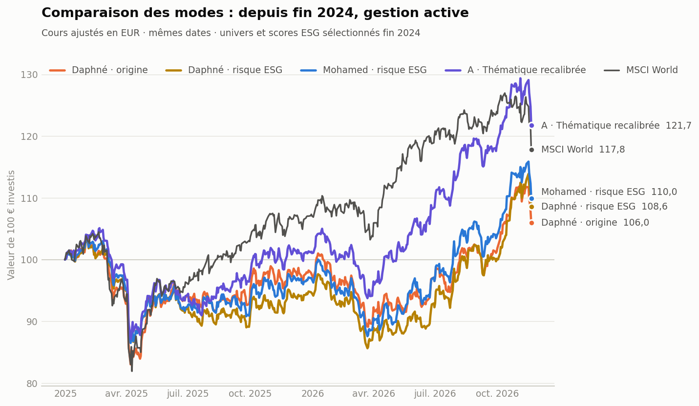
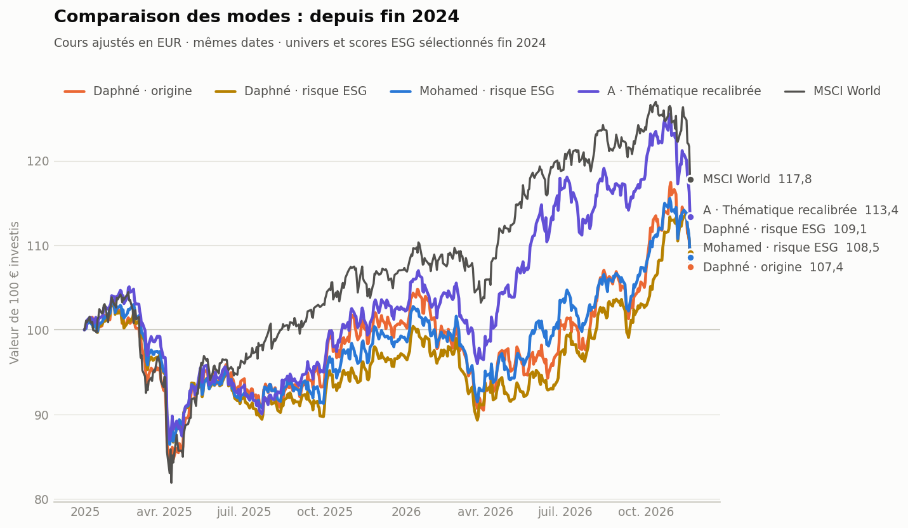
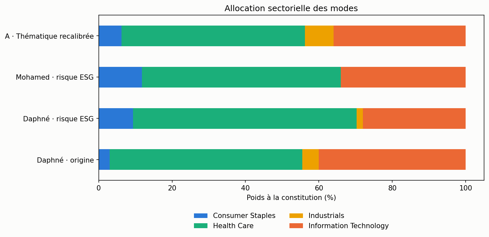

# Résultats et analyse des quatre modes

Exécution du **21 novembre 2026**, avec cours ajustés en EUR jusqu'au **20 novembre 2026**. Les quatre modes ont été exécutés avec succès et **33 tests automatisés passent**. Les chiffres ci-dessous proviennent des CSV générés par la pipeline. [Comparaison complète](../results/comparaison_modes.csv) · [Rendements mensuels des modes](../results/performances_mensuelles_modes.csv) · [Paramètres et empreintes des sources](../results/execution.json).

Après 2024, la **stratégie A (thématique recalibrée)** est la seule à approcher le MSCI World : **+16,9 %** en gestion active et **+15,6 %** à poids figés, contre **+17,8 %** pour l'indice. Les trois premiers modes font +6 à +10 %. A dépasse aussi les ETF MSCI World ESG du marché sur la même période (+12,7 % pour l'ETF SRI, +12,8 % pour l'ETF SRI PAB, d'après les recalculs de la recherche). Sur 2018-2024, A affiche 15,5 %/an et le meilleur Sharpe (0,89).

A a toutefois été conçue après avoir vu 2025-2026. Sa performance après 2024 n'est donc pas une validation indépendante : voir [Méthodologie](methodologie_et_chronologie.md), sections 9 et 10.

## 1. Périmètre de la comparaison

| Élément | Convention |
|---|---|
| Historique rétrospectif | 29/12/2017 → 31/12/2024 ; réoptimisation trimestrielle |
| Après 2024, poids figés (`hors_echantillon`) | 31/12/2024 → 20/11/2026 ; nombre de parts conservé, sans rebalancement |
| Après 2024, gestion active (`hors_echantillon_rebalance`) | Mêmes dates ; poids de constitution puis réoptimisation à chaque fin de trimestre avec les seuls cours connus à la date |
| Benchmark de performance | ETF `IWDA.AS`, proxy investissable du MSCI World en EUR |
| Équipondéré | Même univers que le mode étudié (56 titres Daphné, 47 Mohamed, 88 pour A) |
| Frais | 10 pb sur les montants échangés aux rebalancements ; hors frais initiaux, gestion et fiscalité |
| Calcul du risque | Volatilité hebdomadaire annualisée sur 52 semaines ; perte maximale sur valorisations quotidiennes |
| Ratio de Sharpe | `(rendement annualisé − 2 %) / volatilité` ; taux sans risque fixe |

Le mot « hors échantillon » désigne la période postérieure à la photographie de référence. **Ce n'est pas une validation prospective sans biais** : les filtres ont été travaillés après 2024, l'univers n'est pas reconstruit à chaque date et les fondamentaux n'ont pas tous une date de publication vérifiée. Dans la gestion active, l'univers et les scores ESG restent ceux de fin 2024, faute de données plus récentes. Avant 2025, la sélection fin 2024 crée en plus un biais de survivance d'environ 2 points par an : le MSCI World reconstitué avec ces titres fait 14,6 %/an contre 12,7 % pour IWDA.

## 2. Après 2024

**Poids figés au 31/12/2024**, c'est-à-dire le portefeuille livré :

| Portefeuille | Perf. cumulée | Rendement annualisé | Volatilité | Sharpe | Perte maximale | Tracking error | Bêta |
|---|---:|---:|---:|---:|---:|---:|---:|
| Daphné · origine | +7,42 % | +3,87 % | 16,79 % | 0,111 | −18,77 % | 12,65 % | 0,80 |
| Daphné · risque ESG | +9,08 % | +4,72 % | 13,98 % | 0,194 | −16,02 % | 12,45 % | 0,60 |
| Mohamed · risque ESG | +8,54 % | +4,44 % | 14,48 % | 0,169 | −16,62 % | 11,46 % | 0,69 |
| **A · Thématique recalibrée** | **+15,55 %** | **+7,96 %** | 14,34 % | **0,416** | −16,78 % | **9,39 %** | 0,79 |
| MSCI World (IWDA) | +17,81 % | +9,08 % | 14,24 % | 0,497 | −21,59 % | — | 1 |

**Gestion active** (réoptimisation trimestrielle) :

| Portefeuille | Perf. cumulée | Rendement annualisé | Volatilité | Sharpe | Perte maximale | Tracking error | Bêta | Rotation /an |
|---|---:|---:|---:|---:|---:|---:|---:|---:|
| Daphné · origine | +6,00 % | +3,13 % | 15,22 % | 0,075 | −19,72 % | 11,14 % | 0,77 | 58 % |
| Daphné · risque ESG | +8,60 % | +4,47 % | 14,34 % | 0,172 | −17,07 % | 12,96 % | 0,59 | 28 % |
| Mohamed · risque ESG | +9,95 % | +5,16 % | 14,94 % | 0,211 | −16,58 % | 12,32 % | 0,68 | 27 % |
| **A · Thématique recalibrée** | **+16,89 %** | **+8,63 %** | **13,93 %** | **0,476** | −16,70 % | 9,67 % | 0,75 | 63 % |
| MSCI World (IWDA) | +17,81 % | +9,08 % | 14,24 % | 0,497 | −21,59 % | — | 1 | — |

**Par année** (rendements mensuels composés ; 2026 arrêté au 20/11) :

| Portefeuille | 2025 figé | 2026 figé | 2025 actif | 2026 actif |
|---|---:|---:|---:|---:|
| Daphné · origine | +0,53 % | +6,86 % | −2,54 % | +8,76 % |
| Daphné · risque ESG | −3,28 % | +12,78 % | −5,47 % | +14,88 % |
| Mohamed · risque ESG | −1,11 % | +9,76 % | −3,23 % | +13,62 % |
| **A · Thématique recalibrée** | **+3,54 %** | +11,60 % | +0,14 % | **+16,73 %** |
| MSCI World (IWDA) | +7,08 % | +10,02 % | +7,08 % | +10,02 % |

Ce qu'il faut retenir :

- **A est le seul mode proche de l'indice.** Le retard cumulé tombe à 2,3 points (poids figés) et 0,9 point (gestion active), contre 8 à 12 points pour les trois autres modes. A le fait avec la volatilité la plus basse en gestion active et une perte maximale inférieure de 5 points à celle du MSCI World.
- **Le profil de A est celui d'un fonds santé.** A est en retard en 2025, année où la santé est le pire secteur (+1,8 % en EUR contre +7,3 % pour le marché ; Molina, Sarepta, CSL et Novo Nordisk pèsent). Il rattrape surtout en octobre-novembre 2026, quand la tech chute de 18,5 % et la santé monte de 9,4 %. Au 30/09/2026, A ne faisait que +14,0 % contre +24,0 % pour le MSCI World : **le résultat dépend fortement de la date d'arrêt**.
- **Le rebalancement trimestriel n'aide pas les trois premiers modes** : il ne corrige pas leur sélection (logiciels, pharma sans les gagnants). Il apporte +1,3 point à A, sans que cet écart dépasse le bruit statistique.
- **Les ratios d'information restent négatifs pour tous les modes** : −0,12 (figé) et −0,05 (actif) pour A, contre −0,32 à −0,53 pour les autres.

L'attribution à poids figés de A est disponible dans le [CSV d'attribution](../results/thematique_recalibree/attribution_post2024.csv) :
- premiers apports : Advantest (+3,37 points), NEC (+2,13), United Therapeutics (+1,98), Quest Diagnostics (+1,88), Merck & Co (+1,47) ;
- plus fortes pertes : Molina (−1,17), Novo Nordisk (−1,04), Sarepta (−1,02), Cognizant (−0,97), Salesforce (−0,94).

## 3. Performances mensuelles de A

Gestion active, en % ; novembre 2026 arrêté au 20/11 :

| Année | Série | janv. | févr. | mars | avr. | mai | juin | juil. | août | sept. | oct. | nov. | déc. | Année |
|---|---|---:|---:|---:|---:|---:|---:|---:|---:|---:|---:|---:|---:|---:|
| 2025 | **A** | 3,68 | −0,89 | −6,39 | −3,57 | 2,06 | −0,87 | −0,72 | 1,66 | 1,86 | 3,90 | 0,64 | −0,74 | **0,14** |
| 2025 | MSCI World | 3,86 | −2,53 | −7,89 | −3,91 | 6,37 | 0,88 | 4,78 | −0,33 | 2,51 | 4,26 | −0,34 | 0,12 | 7,08 |
| 2026 | **A** | −0,41 | 1,93 | −6,82 | 3,63 | 4,27 | 2,64 | 3,73 | 5,93 | −1,28 | 7,38 | −4,47 | | **16,73** |
| 2026 | MSCI World | 0,59 | 1,23 | −4,86 | 8,33 | 5,40 | 1,42 | −0,72 | 2,05 | 1,87 | 0,43 | −5,39 | | 10,02 |

Poids figés, en % :

| Année | Série | janv. | févr. | mars | avr. | mai | juin | juil. | août | sept. | oct. | nov. | déc. | Année |
|---|---|---:|---:|---:|---:|---:|---:|---:|---:|---:|---:|---:|---:|---:|
| 2025 | **A** | 3,68 | −0,89 | −6,36 | −3,99 | 1,99 | −0,94 | −1,39 | 2,07 | 2,04 | 7,05 | 1,41 | −0,52 | **3,54** |
| 2026 | **A** | 1,56 | 3,55 | −7,00 | 5,64 | 6,76 | 3,65 | −2,05 | 2,59 | 0,64 | 4,32 | −7,47 | | **11,60** |

A sous-performe surtout de mai à juillet 2025 (rebond des valeurs technologiques et financières) et en avril 2026. Il surperforme en août 2025, de juillet à août 2026 et en octobre 2026.

Fichiers :
- les tableaux année × mois de chaque mode, pour chaque période et avec l'équipondéré, sont dans `results/<mode>/performances_mensuelles.csv` ;
- les rendements mensuels des quatre modes et du MSCI World sur les mêmes dates sont dans [performances_mensuelles_modes.csv](../results/performances_mensuelles_modes.csv).

## 4. Historique : rétrospectif et biaisé à la hausse

| Portefeuille | Rendement annualisé | Volatilité | Sharpe | Perte maximale | Tracking error | Rotation /an |
|---|---:|---:|---:|---:|---:|---:|
| Daphné · origine | +14,79 % | 17,26 % | 0,741 | −27,38 % | 9,67 % | 50 % |
| Daphné · risque ESG | +13,31 % | 15,52 % | 0,729 | −26,37 % | 9,07 % | 24 % |
| Mohamed · risque ESG | +13,80 % | 15,86 % | 0,744 | −27,20 % | 8,96 % | 24 % |
| **A · Thématique recalibrée** | **+15,51 %** | **15,16 %** | **0,891** | −27,48 % | **7,92 %** | 61 % |
| Équipondéré A (88 titres) | +16,03 % | 16,75 % | 0,837 | −27,91 % | 8,58 % | 22 % |
| MSCI World (IWDA) | +12,66 % | 15,63 % | 0,682 | −33,63 % | — | — |
| MSCI World reconstitué (survivants fin 2024) | 14,6 % | — | — | — | — | — |

Repère honnête : le MSCI World reconstitué avec les titres présents fin 2024 (14,6 %/an), pas l'ETF IWDA. Sur ce repère :
- les trois premiers modes ne font pas mieux que le marché ;
- A le dépasse d'environ 0,9 point par an, avec la volatilité la plus basse et le meilleur Sharpe ;
- l'équipondéré de A fait un peu plus en rendement (16,0 %/an), mais avec un Sharpe plus faible.

Par année, A contre le MSCI World :

| | 2018 | 2019 | 2020 | 2021 | 2022 | 2023 | 2024 |
|---|---:|---:|---:|---:|---:|---:|---:|
| A | +5,7 % | +44,7 % | +23,0 % | +23,4 % | −8,4 % | +12,7 % | +14,5 % |
| MSCI World | −4,2 % | +29,6 % | +6,2 % | +32,5 % | −13,5 % | +19,9 % | +27,2 % |

A est en retard lors des envolées des méga-capitalisations tech (2021, 2023, 2024) et en avance lors des baisses (2018, 2022) comme en 2019-2020.

Premier rebalancement : le cache commençant le 02/01/2015, 66 titres de A sur 88 ont 156 semaines complètes le 29/12/2017, dont 48 investis. Au dernier rebalancement de l'historique, les 88 sont disponibles et 59 sont investis. Cet artefact du premier trimestre explique 15,5 %/an ici contre 15,6 % dans le prototype de recherche ; les détails sont dans le [journal d'audit](../results/thematique_recalibree/audit_rebalancements.csv).

## 5. Allocation et contraintes à la constitution

| Indicateur au 31/12/2024 | Daphné origine | Daphné risque ESG | Mohamed risque ESG | A · Thématique recalibrée |
|---|---:|---:|---:|---:|
| Titres sélectionnés | 56 | 56 | 47 | 88 |
| Titres investis (> 0,01 %) | 56 | 56 | 47 | 59 |
| Santé | 52,50 % | 60,89 % | 54,19 % | 54,39 % |
| Technologie | **40,00 %** | **28,00 %** | 34,05 % | 32,47 % |
| Autres secteurs réunis | 7,50 % | 11,11 % | 11,75 % | 13,14 % (industrie 7,82 %, conso. de base 5,32 %) |
| Poids maximum | 4,50 % | 4,05 % | 4,50 % | 4,50 % |
| Titres au plafond de 4,50 % | 12 | 0 | 3 | 1 (NEC) |

A respecte toutes les contraintes à la précision numérique : santé 50-65 %, technologie 28-40 %, autres secteurs ≤ 15 %, ITR ≤ 1,8 °C, intensité carbone ≤ 427 tCO₂e/M$. Au 31/12/2024, ni la contrainte carbone (394 pour 427 autorisés) ni l'ITR (1,70 °C) ne sont actives sur le mélange. Les diagnostics d'optimisation donnent :
- tracking error ex ante : 11,0 % pour le mélange, 10,4 % pour la poche tracking error, 12,2 % pour la poche diversification ;
- ratio de diversification : 2,45 ;
- volatilité modélisée : 11,5 %.

Après 2024, la gestion active garde la santé entre 51 et 55 % et la technologie entre 32 et 36 %, avec 62 à 68 lignes ([audit](../results/thematique_recalibree/audit_rebalancements_post2024.csv), [poids trimestriels](../results/thematique_recalibree/poids_post2024_rebalance.csv)).

Principales lignes de A au 31/12/2024 : NEC 4,50 %, Merck & Co 4,19 %, Elevance Health 4,14 %, United Therapeutics 4,03 %, Cognizant 3,81 %, Cummins 3,43 %, Molina Healthcare 3,31 %, SOBI 2,84 %, Otsuka 2,76 %, Quest Diagnostics 2,76 %. Les dix premières pèsent 35,8 %. La présence de Cummins (moteurs) via la liste discrétionnaire d'industriels reste une décision de groupe.

## 6. ESG : profils améliorés face à l'univers, arbitrages entre modes

| Indicateur pondéré fin 2024 | Daphné origine | Daphné risque ESG | Mohamed risque ESG | A | Univers MSCI World |
|---|---:|---:|---:|---:|---:|
| ITR moyen, °C | 1,518 | 1,519 | 1,572 | 1,704 | 2,397 |
| Intensité carbone scopes 1+2 | 16,41 | 27,68 | 31,88 | 29,42 | 95,89 |
| Intensité carbone scopes 1+2+3 | 255,99 | 289,89 | 322,61 | 393,91 | 854,08 |
| Réduction intensité scopes 1+2+3 vs univers | 70,03 % | 66,06 % | 62,23 % | 53,88 % | — |
| Score net ODD 3 | 1,86 | **2,60** | 2,16 | 1,99 | −0,11 |
| Score net ODD 9 | **1,18** | 1,06 | 0,89 | **1,18** | 0,10 |
| Gouvernance /10 | 6,57 | 6,57 | **6,64** | 6,51 | 5,66 |
| Revenus Taxonomie UE max, % | 2,21 % | 1,92 % | 2,10 % | **4,68 %** | 8,90 % |

Les intensités sont en tCO₂e par million de dollars de chiffre d'affaires. La couverture des indicateurs est de 100 % du poids pour les quatre fonds.

A échange une partie de la marge climatique contre la performance, en restant nettement sous les seuils :
- ITR de 1,70 °C, contre 1,52 °C pour Daphné et 2,40 °C pour le MSCI World ;
- intensité carbone réduite de 54 %, la contrainte imposant au moins 50 %.

Ces indicateurs décrivent la composition à la constitution et ne mesurent ni un impact causé, ni une trajectoire de décarbonation réalisée. Aucun résultat ne certifie une classification Article 9 ou une conformité PAB.

## 7. Qualité des prix et limites

Le cache couvre **88 titres distincts plus IWDA**, sur les dates du 02/01/2015 au 20/11/2026. Les quatre modes disposent de tous leurs cours et d'une observation récente. Pour les trois premiers modes, le rafraîchissement n'a déplacé les cours existants que de 3·10⁻⁴ € au plus, et leurs poids et métriques sont inchangés à 10⁻⁶ près.

L'[audit des prix](../results/qualite_prix.csv) identifie **19 séries avec une variation quotidienne supérieure à 25 %**, conservées sans correction arbitraire. Le mouvement de PTC (+33,43 % le 05/10/2026) est toujours présent.
- Sensibilité au titre PTC entier, pour les trois premiers modes : +7,74 %, +9,19 % et +8,65 % (fichiers `sensibilite_ptc.csv`).
- A n'est pas concernée : PTC y a un poids nul au 31/12/2024.

Les difficultés de données sont détaillées dans la [section 10 de la méthodologie](methodologie_et_chronologie.md) : tickers introuvables, devises mal renseignées, sauts suspects, premier trimestre 2018.

Les résultats restent sensibles au cache Yahoo ajusté, au change, au traitement des jours sans cotation et aux choix faits après la date de référence. L'absence de frais de gestion, de fiscalité et de coûts de liquidité facilite aussi les performances simulées. La période après 2024 dure moins de deux ans, se termine en plein krach technologique, et ne permet pas de conclure à une supériorité structurelle.

## 8. Fichiers à consulter

| Mode | Métriques (3 périodes) | Portefeuille initial | ESG | Mensuel | Attribution |
|---|---|---|---|---|---|
| Daphné origine | [CSV](../results/daphne_original/metriques_backtest.csv) | [CSV](../results/daphne_original/portefeuille_final_pondere.csv) | [CSV](../results/daphne_original/indicateurs_esg.csv) | [CSV](../results/daphne_original/performances_mensuelles.csv) | [CSV](../results/daphne_original/attribution_post2024.csv) |
| Daphné risque ESG | [CSV](../results/daphne_esg_risk/metriques_backtest.csv) | [CSV](../results/daphne_esg_risk/portefeuille_final_pondere.csv) | [CSV](../results/daphne_esg_risk/indicateurs_esg.csv) | [CSV](../results/daphne_esg_risk/performances_mensuelles.csv) | [CSV](../results/daphne_esg_risk/attribution_post2024.csv) |
| Mohamed risque ESG | [CSV](../results/mohamed_esg_risk/metriques_backtest.csv) | [CSV](../results/mohamed_esg_risk/portefeuille_final_pondere.csv) | [CSV](../results/mohamed_esg_risk/indicateurs_esg.csv) | [CSV](../results/mohamed_esg_risk/performances_mensuelles.csv) | [CSV](../results/mohamed_esg_risk/attribution_post2024.csv) |
| A · Thématique recalibrée | [CSV](../results/thematique_recalibree/metriques_backtest.csv) | [CSV](../results/thematique_recalibree/portefeuille_final_pondere.csv) | [CSV](../results/thematique_recalibree/indicateurs_esg.csv) | [CSV](../results/thematique_recalibree/performances_mensuelles.csv) | [CSV](../results/thematique_recalibree/attribution_post2024.csv) |

Les filtres, les objectifs des optimiseurs, la recherche ayant conduit à A, les difficultés et la chronologie sont regroupés dans [Méthodologie et chronologie](methodologie_et_chronologie.md). La commande de reproduction est `python run_pipeline.py` ; le renouvellement des prix est facultatif avec `--refresh-prices`.
