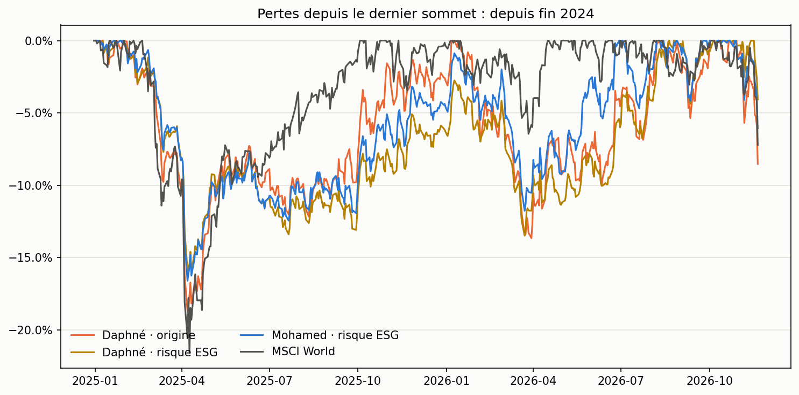
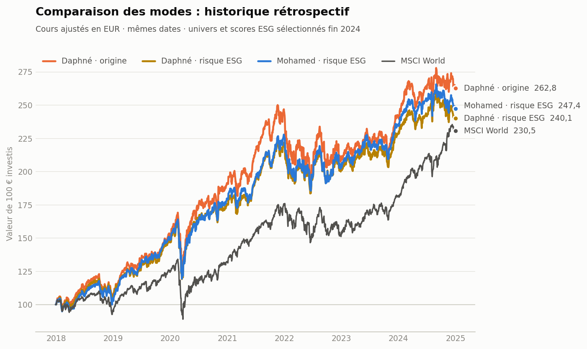

# Résultats et analyse des trois modes

Exécution du **21 novembre 2026**, avec cours ajustés en EUR jusqu'au **20 novembre 2026**. Les trois modes ont été exécutés avec succès, puis reproduits depuis le cache local ; **23 tests automatisés passent**. Les chiffres ci-dessous proviennent des CSV générés par la pipeline ; les anciennes tables fondées sur des moyennes de statistiques individuelles sont remplacées. [Comparaison complète](../results/comparaison_modes.csv) · [Paramètres et empreintes des sources](../results/execution.json).

Sur la période après 2024, **Daphné + risque ESG obtient le meilleur compromis des trois variantes**, mais les trois restent derrière le MSCI World. L'optimisation ESG risque apporte une baisse du risque face à l'équipondération sur cette période ; son avantage ne se retrouve pas systématiquement dans l'historique antérieur.

## 1. Périmètre de la comparaison

| Élément | Convention |
|---|---|
| Historique rétrospectif | 29/12/2017 → 31/12/2024 ; réoptimisation trimestrielle |
| Période après constitution | 31/12/2024 → 20/11/2026 ; nombre de parts conservé, sans rebalancement |
| Benchmark de performance | ETF `IWDA.AS`, proxy investissable du MSCI World en EUR |
| Équipondéré | Même univers que le mode étudié ; 56 titres Daphné ou 47 Mohamed à la constitution |
| Frais | 10 pb sur les montants échangés aux rebalancements ; hors frais initiaux, gestion et fiscalité |
| Calcul du risque | Volatilité hebdomadaire annualisée sur 52 semaines ; perte maximale sur valorisations quotidiennes |
| Ratio de Sharpe | `(rendement annualisé − 2 %) / volatilité` ; taux sans risque fixe |

Le nom de fichier `hors_echantillon` désigne la période postérieure à la photographie de référence. **Ce n'est pas une validation prospective sans biais** : les filtres et leurs variantes ont été travaillés après 2024, l'univers n'est pas reconstruit à chaque date et les fondamentaux n'ont pas tous une date de publication vérifiée. Avant 2025, la sélection et les scores ESG de fin 2024 créent en plus un biais rétrospectif, même si les entrées de marché sont recalculées avec les seuls cours passés.

## 2. Après 2024 : rendement positif, retard sur le marché

| Portefeuille | Performance cumulée | Rendement annualisé | Volatilité | Sharpe | Perte maximale |
|---|---:|---:|---:|---:|---:|
| Daphné · origine | +7,42 % | +3,87 % | 16,79 % | 0,111 | −18,77 % |
| Daphné · risque ESG | **+9,08 %** | **+4,72 %** | **13,98 %** | **0,194** | **−16,02 %** |
| Mohamed · risque ESG | +8,54 % | +4,44 % | 14,48 % | 0,169 | −16,62 % |
| Équipondéré Daphné | +6,47 % | +3,38 % | 15,29 % | 0,090 | −18,72 % |
| Équipondéré Mohamed | +6,44 % | +3,37 % | 16,76 % | 0,081 | −20,30 % |
| MSCI World (IWDA) | **+17,81 %** | **+9,08 %** | 14,24 % | **0,497** | −21,59 % |

À sélection Daphné identique, passer de l'optimiseur d'origine aux budgets de risque ESG ajoute **1,66 point** de performance cumulée et réduit la volatilité de **2,81 points**. La perte maximale s'améliore de **2,76 points**. Le gain est donc visible sur les trois dimensions, sans garantir qu'il persistera.

Face à son équipondéré, Daphné risque ESG gagne **2,61 points** cumulés, avec **1,31 point** de volatilité en moins. Mohamed risque ESG gagne **2,10 points** cumulés face au sien, avec **2,28 points** de volatilité en moins. L'optimiseur d'origine améliore aussi légèrement le rendement de l'équipondéré Daphné, mais augmente sa volatilité et n'améliore pas sa perte maximale.

La comparaison avec le marché reste défavorable : Daphné risque ESG rend **8,72 points** de performance cumulée à IWDA et son Sharpe reste inférieur. Sa volatilité est proche de celle du benchmark, tandis que sa perte maximale est moins profonde de **5,57 points**. Les trois ratios d'information sont négatifs après 2024. Une baisse du drawdown ne suffit donc pas à conclure à une meilleure performance ajustée du risque sur tous les critères.

## 3. Historique : l'équipondération reste un comparateur exigeant

| Portefeuille | Rendement annualisé | Volatilité | Sharpe | Perte maximale |
|---|---:|---:|---:|---:|
| Daphné · origine | +14,79 % | 17,26 % | 0,741 | −27,38 % |
| Daphné · risque ESG | +13,31 % | 15,52 % | 0,729 | **−26,37 %** |
| Mohamed · risque ESG | +13,80 % | 15,86 % | 0,744 | −27,20 % |
| Équipondéré Daphné | +14,31 % | 16,35 % | 0,753 | −27,07 % |
| Équipondéré Mohamed | **+15,36 %** | 17,06 % | **0,783** | −28,50 % |
| MSCI World (IWDA) | +12,66 % | 15,63 % | 0,682 | −33,63 % |

Les trois modes dépassent le rendement annualisé et le Sharpe du benchmark dans cet historique. Cependant, les deux variantes ESG risque restent derrière leur équipondéré en rendement **et en Sharpe** ; la baisse de volatilité s'accompagne d'un coût de performance. Daphné origine gagne seulement **0,47 point par an** face à son équipondéré, avec davantage de risque et un Sharpe légèrement inférieur.

La rotation annuelle **aller simple**, calculée à partir de la moitié du volume achats + ventes, représente environ **50,53 %** pour l'original, contre **23,59 %** et **23,74 %** pour les deux variantes ESG risque. Le volume échangé total vaut deux fois cette rotation ; les frais de 10 pb s'appliquent à ce volume total, et sont intégrés aux trajectoires historiques. Les rotations affichées ne sont pas des frais en pourcentage.

L'historique n'investit pas artificiellement avant la disponibilité des cours : au premier rebalancement, 39 titres Daphné et 32 titres Mohamed ont l'historique requis. Leur nombre évolue ensuite. Les [audits Daphné](../results/daphne_esg_risk/audit_rebalancements.csv) et [audits Mohamed](../results/mohamed_esg_risk/audit_rebalancements.csv) détaillent les titres disponibles et ceux exclus faute d'historique. Cette précaution ne supprime pas le biais de sélection de l'univers fin 2024.

## 4. Allocation et contraintes à la constitution

| Indicateur au 31/12/2024 | Daphné origine | Daphné risque ESG | Mohamed risque ESG |
|---|---:|---:|---:|
| Titres sélectionnés et investis | 56 | 56 | 47 |
| Santé | 52,50 % | 60,89 % | 54,19 % |
| Technologie | **40,00 %** | **28,00 %** | 34,05 % |
| Autres secteurs réunis | 7,50 % | 11,11 % | 11,75 % |
| Poids minimum observé | 1,00 % | 0,55 % | 0,74 % |
| Poids maximum observé | 4,50 % | 4,05 % | 4,50 % |
| Titres au plafond de 4,50 % | 12 | 0 | 3 |

Les trois solveurs convergent, les poids somment à 100 % et toutes les contraintes sont respectées à la précision numérique **aux dates de constitution et de rebalancement**. Les contraintes actives expliquent les différences : l'original atteint la borne haute de 40 % en technologie ; Daphné risque ESG atteint sa borne basse de 28 % ; Mohamed risque ESG atteint le plafond de poids sur Kimberly-Clark, Essity et Ono Pharmaceutical. Aucune variante n'atteint le plafond d'ITR moyen de 1,8 °C à la constitution.

Après 2024, les poids dérivent avec les cours : au 20/11/2026, le poids maximal atteint **10,46 %** dans l'original (Advantest), **5,67 %** dans Daphné risque ESG et **6,35 %** dans Mohamed risque ESG (Ono Pharmaceutical dans ces deux cas). Les plafonds initiaux ne décrivent donc pas les poids de toute la période de détention. Les allocations sectorielles et les indicateurs ESG ci-dessous sont ceux de fin 2024, pas ceux du portefeuille final dérivé.

Les budgets de risque ESG sont des cibles sous contraintes. L'écart maximum entre budget et contribution au risque réalisée atteint **0,029 point** de part du risque pour Daphné et **0,726 point** pour Mohamed ; la somme des écarts absolus vaut respectivement **0,50** et **2,61 points**. Les contraintes empêchent une égalité exacte, sans indiquer un échec du solveur. Les budgets et contributions figurent dans les CSV de portefeuilles, les contrôles dans les fichiers `diagnostics_optimisation.json` de chaque mode.

L'attribution après 2024 décompose exactement le rendement cumulé en `poids initial × rendement du titre en EUR`. Dans l'original, Advantest apporte **+6,74 points**, SOBI **+2,24** et NEC **+2,13**, tandis qu'Intuit coûte **−2,62 points**, Novo Nordisk **−2,45** et Molina **−1,59**. Le rendement du fonds résulte de la somme de toutes les contributions, positives et négatives.

Dans Daphné risque ESG, les premiers apports sont Genmab (**+2,49 points**), Ono (**+2,15**) et Advantest (**+1,64**) ; Novo Nordisk retranche **1,21 point**. Dans Mohamed risque ESG, Ono (**+2,40**), Advantest (**+2,08**) et Biogen (**+1,93**) dominent, contre **−1,72 point** pour Novo Nordisk. Ces calculs identifient les titres moteurs sans attribuer leurs variations à des événements de marché non vérifiés.

## 5. ESG : profils améliorés face à l'univers, arbitrages entre modes

| Indicateur pondéré fin 2024 | Daphné origine | Daphné risque ESG | Mohamed risque ESG | Univers MSCI World |
|---|---:|---:|---:|---:|
| ITR moyen, °C | 1,518 | 1,519 | 1,572 | 2,397 |
| Intensité carbone scopes 1+2 | 16,41 | 27,68 | 31,88 | 95,89 |
| Intensité carbone scopes 1+2+3 | 255,99 | 289,89 | 322,61 | 854,08 |
| Réduction intensité scopes 1+2+3 vs univers | 70,03 % | 66,06 % | 62,23 % | — |
| Score net ODD 3 | 1,86 | **2,60** | 2,16 | −0,11 |
| Score net ODD 9 | **1,18** | 1,06 | 0,89 | 0,10 |
| Gouvernance /10 | 6,57 | 6,57 | **6,64** | 5,66 |
| Revenus Taxonomie UE max, % | 2,21 % | 1,92 % | 2,10 % | 8,90 % |

Les intensités sont exprimées dans les unités du fichier source, en tCO₂e par million de dollars de chiffre d'affaires. La couverture des indicateurs présentés est de **100 % du poids pour les trois fonds**. Pour le benchmark ESG, elle varie de **99,62 % à 99,78 %** ; les moyennes sont renormalisées sur le poids renseigné, sans assimiler les données manquantes à zéro.

L'optimiseur ESG risque Daphné accroît l'exposition santé et le score ODD 3, avec un ITR presque inchangé, mais son intensité carbone est supérieure à celle de l'original. Le mode Mohamed applique une contribution climatique plus stricte tout en autorisant un ITR individuel plus élevé : il ne domine donc pas les deux autres sur les moyennes carbone et température. Ces indicateurs décrivent la composition à la constitution et ne mesurent ni un impact causé ni une trajectoire de décarbonation réalisée.

Le faible niveau de revenus Taxonomie, malgré les filtres durables, rappelle que la règle Mohamed est une alternative **Taxonomie ou SBTi**. Aucun résultat ne certifie une classification Article 9 ou une conformité PAB ; un ITR proche de 1,5 °C ne constitue pas cette certification.

## 6. Qualité des prix et limites

Le cache rafraîchi couvre **64 titres distincts plus IWDA**, sur 3 094 dates du 02/01/2015 au 20/11/2026. Les trois modes disposent de tous leurs cours et d'une observation récente. Les conversions en EUR prennent en compte les sous-unités de cotation ; les valeurs absentes lors des jours fériés sont distinguées de l'absence d'historique avant introduction.

L'[audit des prix](../results/qualite_prix.csv) identifie **11 séries avec une variation maximale supérieure à 25 %**. Une variation élevée n'est pas nécessairement une erreur. Le mouvement de **PTC de +33,43 % le 05/10/2026** est toujours présent après rafraîchissement ; il est conservé, avec besoin de vérification indépendante avant un usage économique des résultats. Aucun choc n'est expliqué par une actualité non vérifiée.

La sensibilité retire **tout le titre PTC**, renormalise les autres poids initiaux puis recalcule la période, sans réoptimisation. Les performances cumulées deviennent **+7,74 %**, **+9,19 %** et **+8,65 %** pour l'original, Daphné risque ESG et Mohamed risque ESG, soit respectivement **+0,32**, **+0,10** et **+0,11 point**. Le classement des trois variantes reste identique. Ce test mesure la dépendance au titre ; il ne corrige ni ne valide le saut du 05/10/2026 et ne garantit pas le respect des contraintes après renormalisation. [Sensibilité originale](../results/daphne_original/sensibilite_ptc.csv) · [Daphné risque ESG](../results/daphne_esg_risk/sensibilite_ptc.csv) · [Mohamed risque ESG](../results/mohamed_esg_risk/sensibilite_ptc.csv).

Les résultats restent sensibles au cache Yahoo ajusté, au change, au traitement des jours sans cotation et aux choix de sélection faits après la date de référence. L'absence de frais de gestion, fiscalité et coûts de liquidité facilite aussi les performances simulées. La période après 2024 dure moins de deux ans et ne permet pas de conclure à une supériorité structurelle.

## 7. Fichiers à consulter

| Mode | Métriques avec équipondéré | Portefeuille initial | ESG | Attribution et poids finaux |
|---|---|---|---|---|
| Daphné origine | [CSV](../results/daphne_original/metriques_backtest.csv) | [CSV](../results/daphne_original/portefeuille_final_pondere.csv) | [CSV](../results/daphne_original/indicateurs_esg.csv) | [CSV](../results/daphne_original/attribution_post2024.csv) |
| Daphné risque ESG | [CSV](../results/daphne_esg_risk/metriques_backtest.csv) | [CSV](../results/daphne_esg_risk/portefeuille_final_pondere.csv) | [CSV](../results/daphne_esg_risk/indicateurs_esg.csv) | [CSV](../results/daphne_esg_risk/attribution_post2024.csv) |
| Mohamed risque ESG | [CSV](../results/mohamed_esg_risk/metriques_backtest.csv) | [CSV](../results/mohamed_esg_risk/portefeuille_final_pondere.csv) | [CSV](../results/mohamed_esg_risk/indicateurs_esg.csv) | [CSV](../results/mohamed_esg_risk/attribution_post2024.csv) |

Les filtres, les objectifs des optimiseurs, les corrections et la chronologie sont regroupés dans [Méthodologie et chronologie](methodologie_et_chronologie.md). La commande de reproduction est `python run_pipeline.py` ; le renouvellement des prix est facultatif avec `--refresh-prices`.
