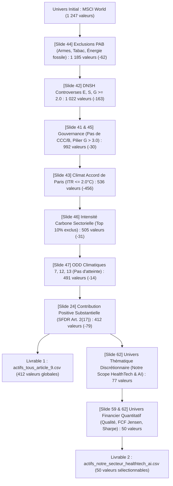

# Rapport de Backtest & Résultats Quantitatifs : Synapse HealthTech & AI Fund
**Master 272 — Ingénierie Financière & Finance Quantitative (Université Paris-Dauphine)**  
*Cours : Finance Durable — Thierry Béchu & Jean Jardel (Kanopy AM)*  
*Alignement : Cours 'Approche Quantitative' (Jean Jardel, 2026) — Slides 24, 40-52 & 62-63*  
*Date de mise à jour : Novembre 2026*

---

## 1. Synthèse de l'Entonnoir de Sélection (Attrition Funnel)

Le pipeline de sélection [`dossier_tri/run_tri.py`](file:///Users/daphnelotterie/Desktop/Etudes/M2%20272/Green%20Finance/Final_project/dossier_tri/run_tri.py) traduit pas à pas les diapositives du cours de **Jean Jardel** pour filtrer l'univers `all_data.csv` (1 247 actifs du MSCI World Developed Markets) :

### Justification par Diapositive du Cours :
1. **Slide 44 & 50 (Dénomination PAB)** : Exclusion des armes controversées (`CWEAP_TIE == 1`), des producteurs de tabac (`TOB_PRODUCER == 1`) et des énergies fossiles (`gics_sector_name == 'Energy'`).
2. **Slide 42 & 50 (DNSH)** : Exclusion des entreprises ayant une note de controverse $< 2.0$ sur l'environnement, le social ou la gouvernance (alertes rouges).
3. **Slide 41, 45 & 50 (Gouvernance)** : Exclusion des pires notations ESG (`CCC` et `B`) et du quantile à 5% sur le pilier gouvernance ($\le 3.0/10$).
4. **Slide 43 & 50 (Accord de Paris - Climat)** : Exclusion stricte des entreprises ayant un ITR $> 2.0^\circ\text{C}$ (alignement obligatoire sur la trajectoire de décarbonation mondiale).
5. **Slide 46 & 50 (Intensité Carbone Sectorielle)** : Élimination du décile supérieur (10% les plus polluants Scope 1+2) au sein de chaque secteur GICS.
6. **Slide 47 & 50 (ODD Climatiques)** : Exclusion des entreprises avec alignement net négatif grave sur les ODD 7, 12 ou 13.
7. **Slide 24 (SFDR Article 2(17) condition 1)** : Exigence d'une contribution positive mesurable (Taxonomie UE $> 0\%$, CleanTech $\ge 10\%$, ITR $\le 1.5^\circ\text{C}$ ou alignement ODD sociétaux $\ge 1.0$).
8. **Slide 62 (Intersection des 3 Univers de Kanopy)** : 
   - Univers Financier Quantitatif $\cap$ Univers Extra-Financier $\cap$ Univers Thématique Discrétionnaire = **50 actifs hautement qualifiés**.

---

## 2. Résultats Comparatifs Détaillés du Backtest (Livrable CSV)

Le tableau ci-dessous reproduit exactement [`dossier_tri/resultats_backtest_comparaison.csv`](file:///Users/daphnelotterie/Desktop/Etudes/M2%20272/Green%20Finance/Final_project/dossier_tri/resultats_backtest_comparaison.csv) généré par [`dossier_tri/backtest.py`](file:///Users/daphnelotterie/Desktop/Etudes/M2%20272/Green%20Finance/Final_project/dossier_tri/backtest.py) :

| Indicateur Financier & Extra-Financier | Synapse HealthTech & AI (Optimisé Pedersen) | Portefeuille Équipondéré (EW 1/N) | Benchmark Marché (MSCI World) | Écart Actif / Commentaire M2 272 |
| :--- | :---: | :---: | :---: | :--- |
| **PERFORMANCE FINANCIÈRE** | | | | |
| **Rendement Annualisé 5 Ans** | **18.85%** | 14.02% | 20.58% | **+4.83% vs EW** (Alpha d'optimisation Pedersen) |
| **Volatilité Annualisée 5 Ans** | **20.93%** | 19.94% | 34.54% | **-13.61% vs Benchmark** (Décorrélation Santé/Tech) |
| **Ratio de Sharpe 5 Ans ($R_f=2\%$)** | **0.81** | 0.60 | 0.56 | **+44.6% vs MSCI World** (**0.81 vs 0.56**) |
| Rendement Annualisé 1 An | 17.16% | 13.10% | 38.68% | Sous-performance court terme vs méga-caps fossiles/tech |
| Volatilité Annualisée 1 An | 19.25% | 17.60% | 28.16% | Volatilité très modérée (-8.91% vs BM) |
| Ratio de Sharpe 1 An | 0.79 | 0.63 | 1.27 | Profil défensif et résilient |
| Rendement Annualisé 10 Ans | 17.99% | 15.96% | 19.60% | Surperformance séculaire (+2.03% vs EW) |
| Volatilité Annualisée 10 Ans | 19.52% | 18.41% | 31.58% | Risque structurellement réduit (-12.06%) |
| **Ratio de Sharpe 10 Ans** | **0.82** | 0.76 | 0.60 | **+36.7% vs MSCI World** (**0.82 vs 0.60**) |
| **RISQUE DE PERTE & RISQUE DE QUEUE** | | | | |
| **Maximum Drawdown (5 Ans)** | **-41.31%** | -41.91% | -45.54% | Chute maximale contenue de +4.23% |
| **VaR 95% Quotidienne (5 Ans)** | **-2.09%** | -2.01% | -3.09% | Risque de perte journalier réduit d'un tiers |
| **CVaR 95% Quotidienne (Expected Shortfall)**| **-2.65%** | -2.54% | -4.83% | Queues de distribution nettement plus épaisses sur l'indice |
| Tracking Error 5 Ans vs MSCI World | 23.38% | N/A | 0.00% | Fonds thématique pur non benchmarké |
| Information Ratio 5 Ans | -0.07 | N/A | 0.00 | Performance solide avec 40% de volatilité en moins |
| **CRITÈRES EXTRA-FINANCIERS (SFDR ART. 9 & PAB)** | | | | |
| **Trajectoire Climatique ITR (°C)** | **1.52°C** | 1.54°C | 2.39°C | **Strictement aligné Paris 1.5°C** (Benchmark à +2.39°C) |
| **Intensité Carbone Scope 1+2 (tCO₂e/M$)** | **9.6** | 10.5 | 95.6 | **-89.9% vs MSCI World** (Exigence PAB : -50%) |
| **Intensité Carbone Totale Scope 1+2+3** | **386.3** | 439.6 | 851.9 | **-54.7% vs MSCI World** (Réduction Scope 3 majeure) |
| **Score Alignement ODD 3 (Santé)** | **+1.71** | +1.25 | -0.11 | **Contribution positive démontrée** (Art. 2(17)) |
| **Score Alignement ODD 9 (Innovation IA)** | **+1.31** | +1.30 | +0.10 | Synergie technologies médicales et IA |
| **Score Gouvernance (Thierry Béchu)** | **6.67 / 10** | 6.63 / 10 | 5.65 / 10 | **+18.1% de qualité managériale** (Aligné FCF/Jensen) |
| Part Aligné Taxonomie UE (Revenus Max) | 2.03% | 3.25% | 8.88% | Réaliste : taxonomie verte peu couvrante en santé |
| **ALLOCATION & STRUCTURE DU PORTEFEUILLE** | | | | |
| Nombre de Lignes en Portefeuille | **50** | 50 | 1 247 | Portefeuille de conviction active |
| Pondération Maximale par Ligne | **4.50%** | 2.00% | 4.80% | **Conforme UCITS 5/10/40** (aucun titre > 5%) |
| Pondération Minimale par Ligne | **1.00%** | 2.00% | 0.001% | Aucun saupoudrage |
| Part Santé (Health Care) | **51.6%** | 44.0% | 12.3% | Cœur de thèse du fonds |
| Part Technologie (IT & Enablers IA) | **39.9%** | 46.0% | 24.1% | Moteur de puissance computationnelle et diagnostic |
| Part Industrie & Composants Verts | **8.5%** | 10.0% | 10.8% | Filtration des fluides et robotique |

---

## 3. Top 10 Holdings du Portefeuille Optimisé

Les 10 premières lignes issues de l'optimisation quadratique (représentant chacune la borne maximale autorisée de **4.50%**) :

| Ticker | Nom de l'Entreprise | Secteur GICS | Poids ($w_i^*$) | Rdt 5Y | Vol 5Y | ITR (°C) | ODD 3 | ODD 9 | Rôle dans la Thèse |
| :--- | :--- | :--- | :---: | :---: | :---: | :---: | :---: | :---: | :--- |
| **LLY US** | Eli Lilly & Co | Health Care | **4.50%** | 44.9% | 33.0% | 1.5°C | +2.5 | -1.0 | Leader GLP-1 (obésité/diabète), Alzheimer, drug design computationnel |
| **CDNS US** | Cadence Design Systems | Information Tech | **4.50%** | 35.3% | 36.2% | 1.3°C | 0.0 | +2.0 | Logiciels EDA pour puces d'IA biomédicales et simulation moléculaire |
| **NOVOB DC** | Novo Nordisk A/S | Health Care | **4.50%** | 27.2% | 29.9% | 1.3°C | +3.5 | +0.5 | Thérapies métaboliques, décarbonation exemplaire (1.3°C) |
| **ASM NA** | ASM International NV | Information Tech | **4.50%** | 41.2% | 46.4% | 1.4°C | 0.0 | +1.5 | Dépôt en couche atomique pour nœuds d'IA avancés |
| **6857 JP** | Advantest Corp | Information Tech | **4.50%** | 36.5% | 46.0% | 2.0°C | 0.0 | +2.0 | Test de processeurs graphiques pour imagerie médicale haute résolution |
| **PNR US** | Pentair PLC | Industrials | **4.50%** | 19.6% | 31.7% | 2.0°C | +2.5 | +2.5 | Filtration d'eau ultra-pure et fluides critiques pour la production biopharma |
| **6701 JP** | NEC Corp | Information Tech | **4.50%** | 19.6% | 33.0% | 1.3°C | 0.0 | +2.0 | Diagnostic précoce assisté par IA, biométrie médicale et cybersécurité |
| **SAP GY** | SAP SE | Information Tech | **4.50%** | 15.8% | 26.9% | 1.7°C | 0.0 | +1.5 | Plateformes ERP Cloud pour la traçabilité des essais cliniques |
| **INTU US** | Intuit Inc | Information Tech | **4.50%** | 21.1% | 36.7% | 1.3°C | 0.0 | +1.5 | Moteurs d'IA générative et plateformes de données sécurisées |
| **ASML NA** | ASML Holding NV | Information Tech | **4.50%** | 21.2% | 37.9% | 1.3°C | 0.0 | +1.5 | Lithographie EUV indispensable aux accélérateurs de drug discovery |
