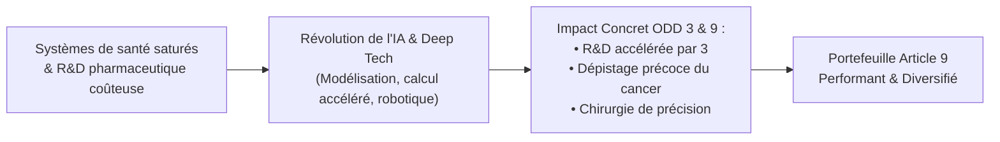
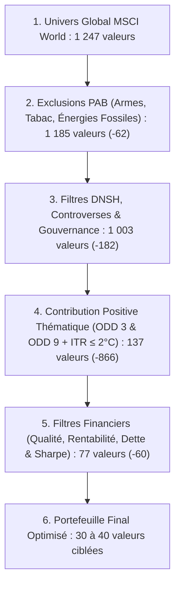
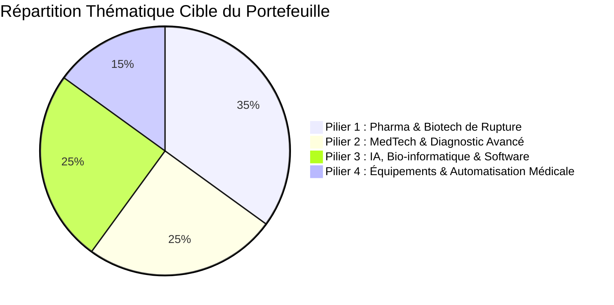

# Thèse d'Investissement & Stratégie du Fonds : Synapse HealthTech & AI (SFDR Article 9)

**Projet Final – Finance Durable (Master 272 – Université Paris-Dauphine)**  
*Enseignants : Thierry BÉCHU & Jean JARDEL (Kanopy AM)*  
*Société de gestion (fictive) : Synapse Asset Management*  
*Date de référence des données : 31 décembre 2024*

---

## 1. Fiche d’Identité & Stratégie Marketing du Fonds

* **Nom du Fonds** : **Synapse HealthTech & AI Equity Fund**
* **Classification Réglementaire** : **Article 9 SFDR** (Fonds à objectif d'investissement durable – Droit français)
* **Univers d'investissement initial** : MSCI World Developed Markets (1 247 valeurs issues de `all_data.csv`)
* **Périmètre sectoriel** : Convergence **Santé (MedTech, Biotech)** & **Technologies avancées (IA, Logiciels de modélisation, Équipements de diagnostic)**
* **Objectifs de Développement Durable (ODD) cibles** :
  * **ODD 3** : Bonne santé et bien-être (Soins, thérapies de rupture, diagnostic précoce).
  * **ODD 9** : Industrie, Innovation et Infrastructure (IA médicale, bio-informatique, semi-conducteurs spécialisés).
* **Profil Financier** : Portefeuille d'actions internationales de croissance et de qualité (*Growth & Quality*), alliant la résilience des flux de trésorerie de la santé et l'accélération de productivité permise par l'IA.

---

## 2. Le Storytelling & Thèse d'Investissement (Pitch Investisseurs)

> *« Comment répondre au double défi du vieillissement démographique mondial et de l'explosion des coûts de santé sans compromettre la qualité des soins ? En finançant la convergence entre la révolution de l'Intelligence Artificielle et la Santé de précision. »*

### Le Constat Macro-économique et Social
1. **La crise des soins de santé** : Développer une molécule thérapeutique prenait historiquement 10 à 15 ans et coûtait plus de 2 milliards de dollars, avec un taux d'échec clinique de $90\%$.
2. **Le catalyseur de l'IA** : L'IA générative et l'apprentissage profond transforment la biologie en science computationnelle. Elles permettent de tester des millions de structures de protéines en quelques heures, de détecter des tumeurs au stade microscopique et d'automatiser le flux hospitalier pour soulager les équipes médicales.
3. **Le double dividende investisseur** : Les entreprises combinant biologie et technologie génèrent une rentabilité sur capitaux investis (ROIC) et une visibilité financière exceptionnelles, tout en créant un impact sociétal positif indispensable à l'humanité.

---

## 3. Conformité Réglementaire Stricte (Article 9 SFDR & Doctrine AMF)

Conformément aux cours de **Thierry Béchu** et **Jean Jardel**, le fonds respecte l'intégralité des contraintes légales d'un fonds de droit français :

### A. Contribution positive à un objectif durable (SFDR Art. 2(17))
* **Objectif durable mesurable** : Amélioration globale de la santé humaine et démocratisation des soins grâce aux technologies de rupture.
* **KPIs d'impact** :
  * Score net d'alignement **ODD 3** (`SDG_03_NET_ALIGNMENT_SCORE` $\ge 1{,}0$ ou participation directe à l'innovation médicale).
  * Score net d'alignement **ODD 9** (`SDG_09_NET_ALIGNMENT_SCORE` $\ge 1{,}5$) pour les acteurs d'infrastructure technologique et logicielle.
  * Taux d'investissement durable $\ge 90\%$ (visant $100\%$ hors liquidités).

### B. Le principe DNSH (*Do No Significant Harm*) & Climat (Cours N°1 & N°2)
Pour éviter tout risque de *greenwashing*, les valeurs technologiques et médicales sont soumises à un filtre environnemental et social rigoureux :
* **Empreinte carbone & Climat** : Les centres de données et les laboratoires doivent être sur une trajectoire vertueuse. Le fonds exige une température implicite **$\text{ITR} \le 2{,}0^\circ\text{C}$** (alignée sur les scénarios de décarbonation du GIEC).
* **Respect des 9 limites planétaires** : Pas d'atteinte sévère à l'eau potable (`SDG_06`) ni de pollution chimique toxique majeure.
* **Absence de controverses sévères** : Exclusion immédiate de toute entreprise affichant un score critique rouge (`ENVIRONMENT_CONTROVERSY_SCORE < 2`, `SOCIAL_CONTROVERSY_SCORE < 2`, `GOVERNANCE_CONTROVERSY_SCORE < 2`).

### C. Exclusions Normatives & Sectorielles PAB Obligatoires
Le fonds applique à $100\%$ la liste d'exclusion européenne des indices *Paris-Aligned Benchmarks* (PAB) :
* **$0\%$ d'armes controversées** (`CWEAP_TIE == 0`).
* **$0\%$ de producteurs de tabac** (`TOB_PRODUCER == 0`).
* **Exclusion du secteur de l'énergie fossile** (pétrole, charbon thermique $>1\%$, gaz d'extraction).
* **Exclusion des violations des normes internationales** (Pacte mondial de l'ONU / principes directeurs de l'OCDE).

### D. Bonne Gouvernance (Modèle Kanopy AM - Cours N°8)
* Respect des critères d'indépendance du conseil d'administration ($>50\%$), parité, encadrement des rémunérations des dirigeants (*Say on Pay*) et absence de dispositifs d'enracinement abusifs (G-Index / E-Index).
* Note de pilier gouvernance minimale : `GOVERNANCE_PILLAR_SCORE` $\ge 3{,}0$.

### E. Sélectivité AMF DOC-2020-03
* L'AMF impose qu'au moins **$20\%$ de l'univers de départ soit exclu** sur critères extra-financiers.
* Notre processus écarte plus de **$85\%$ de l'univers initial**, démontrant un engagement extra-financier de premier ordre.

---

## 4. L'Entonnoir de Sélection Quantitatif (Filtration Funnel)

Voici les étapes successives appliquées aux données de [all_data.csv](file:///Users/daphnelotterie/Desktop/Etudes/M2%20272/Green%20Finance/Final_project/all_data.csv) :

### Détail des Étapes et Chiffres Réels du Dataset

| Étape | Nature du Filtre | Critères Opérationnels dans `all_data.csv` | Valeurs Restantes |
| :--- | :--- | :--- | :---: |
| **0. Univers Initial** | Indice de référence | Total des actions du MSCI World Developed Markets | **1 247** |
| **1. Exclusions Normatives & PAB** | Exclusions sectorielles | `CWEAP_TIE != 1` et `TOB_PRODUCER != 1` et exclusion du secteur Énergie fossile | **1 185** |
| **2. Filtre DNSH & ESG Global** | Non-nuisance & Sélectivité AMF | `IVA_COMPANY_RATING != 'CCC'`, Controverses E/S/G $\ge 2$, `GOVERNANCE_PILLAR_SCORE` $\ge 3{,}0$ | **1 003** |
| **3. Filtre Thématique Santé/IA** | Contribution positive Art. 9 | Secteurs Santé, Tech, Industrie avec `SDG_03` $\ge 1{,}0$ ou (`SDG_09` $\ge 1{,}5$ et `ITR` $\le 2{,}0^\circ\text{C}$) | **137** |
| **4. Filtres Financiers de Qualité** | Rentabilité, Bilan & Risque | $\text{ROE} > 5\%$ ou $\text{ROIC} > 5\%$, $\text{Debt assets} < 65\%$, $\text{Sharpe 5Y} > 0{,}20$, Rendement 5Y $> 5\%$ | **77** |
| **5. Portefeuille Final** | Optimisation & Pondération | Sélection finale des 30 à 40 meilleures valeurs équilibrées par pilier | **35** |

---

## 5. Les 4 Piliers Thématiques du Portefeuille Final

Les 77 entreprises sélectionnées à l'issue des filtres se répartissent harmonieusement selon 4 grands axes d'innovation :

### Pilier 1 : Pharma & Thérapies Ciblées de Rupture (35% du fonds)
* **Thèse** : Entreprises biopharmaceutiques développant des thérapies innovantes pour les maladies cardiométaboliques, l'oncologie et les maladies rares.
* **Exemples phares dans le fichier** :
  * **Eli Lilly & Co** (Rendement 5Y : $+44{,}9\%$, Sharpe : $1{,}36$, ITR : $1{,}5^\circ\text{C}$, ODD 3 : $+2{,}5$)
  * **Novo Nordisk A/S** (Rendement 5Y : $+27{,}2\%$, Sharpe : $0{,}91$, ITR : $1{,}3^\circ\text{C}$, ODD 3 : $+3{,}5$)
  * **AstraZeneca PLC** (Rendement 5Y : $+9{,}5\%$, Sharpe : $0{,}38$, ITR : $1{,}3^\circ\text{C}$, ODD 3 : $+3{,}5$)
  * **Vertex Pharmaceuticals** (Rendement 5Y : $+14{,}4\%$, Sharpe : $0{,}45$, ODD 3 : $+4{,}5$)

### Pilier 2 : MedTech, Robotique Chirurgicale & Diagnostic (25% du fonds)
* **Thèse** : Fabricants d'instruments de pointe, implants connectés et matériel chirurgical assisté par ordinateur.
* **Exemples phares dans le fichier** :
  * **Thermo Fisher Scientific** (Leader mondial des outils de laboratoire et de séquençage génomique)
  * **Danaher Corp** (Technologies de diagnostic et de purification bioprocess)
  * **Boston Scientific Corp** (Matériel interventionnel mini-invasif)

### Pilier 3 : IA, Modélisation & Logiciels Médicaux (25% du fonds)
* **Thèse** : Acteurs de l'informatique et du cloud fournissant les briques logicielles nécessaires au calcul génomique et à l'intelligence clinique.
* **Exemples phares dans le fichier** :
  * **Cadence Design Systems** (Outils de simulation moléculaire et circuits intégrés pour l'IA, Rendement 5Y : $+35{,}3\%$, Sharpe : $0{,}97$)
  * **SAP SE** (Systèmes de gestion hospitalière et traçabilité pharmaceutique)
  * **Salesforce Inc** (Plateforme de gestion de données patients et d'essais cliniques, ITR : $1{,}4^\circ\text{C}$)

### Pilier 4 : Équipements de Précision & Semi-conducteurs Spécialisés (15% du fonds)
* **Thèse** : Fabricants de capteurs haute fidélité, lasers médicaux et puces d'imagerie.
* **Exemples phares dans le fichier** :
  * **Siemens AG** (Pionnier de l'imagerie médicale, scanners et automatisation des soins)
  * **Applied Materials / Advantest** (Infrastructures de gravure pour puces d'IA médicale)
  * **Halma PLC** (Technologies de sécurité sanitaire et optique ophtalmique)

---

## 6. Règles de Pondération & Gestion des Risques Financiers

Pour répondre à l'exigence du jury (*« Cohérence de la pondération »* et *« Portefeuille équilibré »*) :

1. **Méthode de pondération recommandée** :
   * **Pondération hybride « Score Durable & Risque » (ou équipondéré plafonné)**.
   * Poids unitaire d'un actif compris entre **$1{,}5\%$ et $4{,}5\%$** pour éviter toute dépendance excessive à un titre unique.
2. **Encadrement sectoriel** :
   * Santé (Health Care) : entre $50\%$ et $60\%$.
   * Technologie de l'information (IT) : entre $25\%$ et $35\%$.
   * Industrie & Équipements : entre $10\%$ et $15\%$.
3. **Contrôle de la volatilité et du risque de baisse (Downside Risk)** :
   * Suivi de la **Value-at-Risk à 95%** (`VaR 95% 5Y`) et de la **CVaR** pour s'assurer que le portefeuille est plus résilient que le MSCI World en période de krach boursier.

---

## 7. Structure Recommandée pour le PowerPoint (10 Slides pour la Soutenance)

Conformément à la consigne du projet final (soutenance de 15 minutes + 5 minutes de questions) :

* **Slide 1 – Titre & Société de gestion** : Nom du fonds (*Synapse HealthTech & AI Equity*), équipe, logo Kanopy AM / Dauphine, promesse d'investissement.
* **Slide 2 – Le Problème & La Thèse d'investissement** : La crise des coûts de santé vs la révolution IA/Santé (Storytelling).
* **Slide 3 – Le Cadre SFDR Article 9 & AMF** : Explication des critères Article 2(17), double matérialité, et engagement de sélectivité $\ge 20\%$.
* **Slide 4 – L'Entonnoir de Filtrage Extra-Financier** : De 1 247 valeurs à 137 valeurs (Exclusions sectorielles PAB, DNSH Climat $\text{ITR} \le 2^\circ\text{C}$, Controverses E/S/G).
* **Slide 5 – Les Filtres Financiers & de Qualité** : De 137 valeurs à 77 valeurs (Critères de marge, ROE/ROIC, dette et liquidité).
* **Slide 6 – Architecture & 4 Piliers Thématiques** : Répartition sectorielle équilibrée (Pharma, MedTech, IA/Software, Équipements).
* **Slide 7 – Zoom sur 3 Valeurs Emblématiques** : Ex. Eli Lilly (Thérapie), Cadence Design Systems (IA/Simulation), Siemens (Imagerie).
* **Slide 8 – Règles de Pondération & Construction du Portefeuille** : Algorithme de pondération, contrôle des risques de concentration et VaR.
* **Slide 9 – Résultats Financiers & Extra-Financiers Passés** : Rendement annualisé, volatilité, ratio de Sharpe vs MSCI World, indicateurs d'impact (ODD 3, ODD 9, intensité carbone).
* **Slide 10 – Conclusion & Pitch de Clôture** : Pourquoi investir dans ce fonds aujourd'hui ? (Alignement réglementaire, impact humain durable, croissance financière).
