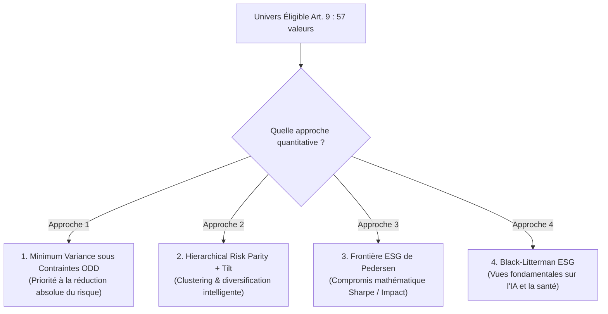
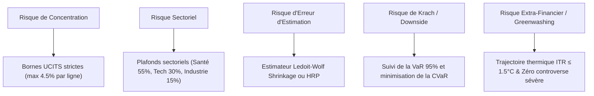

# Stratégies Quantitatives d'Allocation & Gestion des Risques
*Fonds Synapse HealthTech & AI (SFDR Article 9)*  
*Master 272 – Financial Engineering / Quantitative Finance track (Université Paris-Dauphine)*  
*Enseignants : Thierry BÉCHU & Jean JARDEL (Kanopy AM)*

---

## 1. Contexte & Enjeu pour le Master 272

Notre univers est désormais filtré et **100% conforme à l'Article 9 SFDR** (57 entreprises d'excellence réparties entre Santé, MedTech, IA médicale et équipements de diagnostic dans [actifs_notre_secteur_healthtech_ai.csv](file:///Users/daphnelotterie/Desktop/Etudes/M2%20272/Green%20Finance/Final_project/dossier_tri/actifs_notre_secteur_healthtech_ai.csv)).

La question centrale de la consigne (Slide 2 & 4 du projet) est :
> *« Proposer une pondération cohérente et construire un portefeuille équilibré et performant. »*

En tant qu'étudiants en ingénierie financière et finance quantitative, une simple équipondération ($1/N$, c'est-à-dire donner le même pourcentage à tout le monde) serait trop basique. À l'inverse, un modèle hors-sol serait inapplicable. 

Voici **4 stratégies quantitatives professionnelles, réalistes, autorisées par la réglementation AMF/UCITS**, expliquées d'abord avec des **mots simples**, puis avec leur **formulation mathématique et académique**.

---

## 2. Synthèse Comparative des 4 Stratégies

| Stratégie | L'idée en 1 phrase | Niveau Mathématique | Avantage n°1 pour la Soutenance |
| :--- | :--- | :---: | :--- |
| **1. Minimum Variance sous Contraintes ODD** | *« Trouver le mélange d'actions qui bouge le moins possible, tout en forçant un impact santé et climat très élevé. »* | Accessible (Solveur quadratique) | **Le plus stable et intuitif**, ultra-défensif en période de baisse. |
| **2. Hierarchical Risk Parity (HRP) + Tilt Impact** | *« Regrouper les actions par familles qui se ressemblent (IA vs Biotechs) et donner à chaque famille la même part de risque. »* | Avancé (Machine Learning non supervisé / Graphes) | **Le coup de cœur pour un Quant Researcher** (zéro inversion de matrice). |
| **3. Frontière Efficiente ESG (Pedersen et al.)** | *« Maximiser le rendement en payant le juste prix pour le risque, avec un bonus mathématique pour les entreprises les plus vertueuses. »* | Modéré (Extension moderne de Markowitz) | **Publication académique de référence** (JFE 2021). |
| **4. Black-Litterman ESG** | *« Partir des poids du marché et corriger les prévisions en fonction de nos convictions technologiques et médicales. »* | Élevé (Probabilités bayésiennes) | **La méthode reine des banques et grands gérants** (Goldman Sachs, BlackRock). |

---

## 3. Détail des Stratégies

---

### Stratégie 1 : Minimum Variance sous Contraintes d'Impact (Recommandée pour son équilibre)

#### 💡 En mots simples
Imaginons que vous préparez une équipe pour une traversée en mer : vous ne voulez pas prendre des gens qui paniquent tous au même moment.  
Le Minimum Variance cherche mathématiquement **la combinaison exacte d'actions dont les variations s'annulent entre elles**, pour obtenir un portefeuille dont la valeur reste la plus stable possible dans le temps.  
En plus, on impose des **garde-fous obligatoires** :
1. *Pas de chouchou excessif* : aucune action n'a le droit de dépasser $4{,}5\%$ (conformité AMF/UCITS).
2. *Impact santé garanti* : la moyenne du portefeuille sur l'ODD 3 doit être excellente ($\ge 2{,}5$).
3. *Climat maîtrisé* : la température moyenne pondérée doit rester sous les $1{,}5^\circ\text{C}$.

#### 📐 Formulation Quantitative (M2 272)
On résout le programme d'optimisation quadratique convexe suivant :
$$\min_{w} \quad \sigma_p^2 = w^T \Sigma w$$
*Sous les contraintes linéaires suivantes :*
* **Budget & Interdiction de vente à découvert** : $\sum_{i=1}^N w_i = 1$ et $w_i \ge 1{,}0\%$ (tous les actifs sélectionnés sont représentés).
* **Règle UCITS 5/10/40 & Anti-concentration** : $w_i \le 4{,}5\% \quad \forall i$.
* **Contrainte d'Impact ODD 3 (Santé)** : $\sum_{i=1}^N w_i \cdot \text{SDG\_03}_i \ge 2{,}5$.
* **Contrainte Thermique PAB (Climat)** : $\sum_{i=1}^N w_i \cdot \text{ITR}_i \le 1{,}5^\circ\text{C}$.
* **Équilibre sectoriel** :
  * $50\% \le \sum_{i \in \text{Santé}} w_i \le 65\%$
  * $25\% \le \sum_{i \in \text{Tech/IA}} w_i \le 35\%$
  * $10\% \le \sum_{i \in \text{Industrie}} w_i \le 15\%$

$\Sigma$ est estimée à l'aide d'un estimateur de rétrécissement (*shrinkage*) de **Ledoit-Wolf (2004)** pour éviter les erreurs d'échantillonnage sur les séries historiques.

---

### Stratégie 2 : Hierarchical Risk Parity (HRP) avec Tilt Santé/IA (Le top pour un profil Quant)

#### 💡 En mots simples
Dans notre sélection de 57 entreprises, il y a des actions qui bougent ensemble (par exemple deux laboratoires pharmaceutiques comme Novo Nordisk et Eli Lilly réagissent souvent aux mêmes nouvelles sur les médicaments). À l'inverse, une entreprise de puces électroniques pour l'imagerie médicale ne réagit pas du tout de la même façon.  
La méthode HRP utilise un algorithme d'**arbre généalogique (dendrogramme)** :
1. Elle regroupe les actions en sous-familles naturelles selon leur comportement réel de marché.
2. Elle attribue à chaque sous-famille une part équitable du risque total.
3. Elle évite le piège classique de Markowitz qui nécessite d'inverser des matrices géantes (ce qui provoque souvent des erreurs aberrantes en pratique).
4. On applique ensuite un petit bonus (*tilt*) pour surpondérer légèrement les entreprises qui ont les meilleurs scores d'innovation IA et d'impact santé.

#### 📐 Formulation Quantitative (M2 272)
*Réf. : Marcos López de Prado (Journal of Portfolio Management, 2016)*
1. **Distance de corrélation** : On transforme la matrice de corélation $C$ en distance métrique :
   $$d_{i,j} = \sqrt{\frac{1 - \rho_{i,j}}{2}}$$
2. **Clustering hiérarchique** : On applique l'algorithme de liaison simple ou de Ward pour créer la matrice d'arbre et réordonner les actifs (quasi-diagonalisation).
3. **Bisection récursive** : Pour chaque sous-cluster $V = V_1 \cup V_2$, le poids alloué à chaque branche est inversement proportionnel à sa variance :
   $$\alpha_1 = 1 - \frac{\tilde{V}_1}{\tilde{V}_1 + \tilde{V}_2}$$
4. **Tilt d'Impact Article 9** :
   $$w_i^* = \frac{w_{i, \text{HRP}} \cdot (1 + \lambda \cdot z_{\text{ODD}, i})}{\sum_j w_{j, \text{HRP}} \cdot (1 + \lambda \cdot z_{\text{ODD}, j})}$$
   où $z_{\text{ODD}, i}$ est le z-score normalisé de l'impact sociétal et technologique.

---

### Stratégie 3 : La Frontière Efficiente ESG (Pedersen, Fitzgibbons & Pomorski, 2021)

#### 💡 En mots simples
Dans la finance traditionnelle inventée dans les années 1950 (Markowitz), l'investisseur ne regarde que 2 choses : combien ça rapporte (rendement) et combien ça bouge (risque).  
Dans la finance durable moderne, ce papier primé de 2021 prouve mathématiquement qu'il existe une **3ᵉ dimension : l'utilité extra-financière (l'Impact)**.  
L'investisseur accepte de guider son capital vers les entreprises les plus vertueuses tant que cela ne détruit pas sa rentabilité financière. Le modèle cherche le point parfait de la courbe à 3 dimensions.

#### 📐 Formulation Quantitative (M2 272)
*Réf. : Pedersen, Fitzgibbons, Pomorski (Journal of Financial Economics, 2021)*
$$\max_{w} \quad U(w) = w^T \mu - \frac{\gamma}{2} w^T \Sigma w + \theta \cdot (w^T S_{\text{HealthTech}})$$
*Sous contraintes :* $\sum w_i = 1$, $1\% \le w_i \le 4{,}5\%$.
* $\gamma$ : Coefficient d'aversion au risque financier.
* $\theta$ : Préférence de l'investisseur pour l'impact extra-financier (spécifique à l'Article 9).
* $S_{\text{HealthTech}}$ : Score composite normalisé :
  $$S_i = 0{,}5 \cdot z(\text{SDG\_03}_i) + 0{,}3 \cdot z(\text{SDG\_09}_i) + 0{,}2 \cdot z(\text{GovPillar}_i)$$

---

### Stratégie 4 : Le Modèle Black-Litterman avec Vues Fondamentales ESG

#### 💡 En mots simples
La plupart des modèles quantitatifs se basent uniquement sur le rétroviseur (les performances passées).  
Black-Litterman est le modèle inventé chez Goldman Sachs pour mélanger intelligemment deux choses :
1. Ce que le marché pense aujourd'hui (l'équilibre mondial du MSCI World).
2. Vos **convictions d'analystes quantitatifs** sur l'avenir (vos *« Vues »*).  
Par exemple : *« Nous avons la conviction statistique que l'IA va accélérer de +2% le rendement annuel des entreprises de bio-informatique grâce aux économies de coûts de R&D »*. Le modèle fusionne ces deux visions par les probabilités bayésiennes sans créer de surpondérations folles.

#### 📐 Formulation Quantitative (M2 272)
*Réf. : Fischer Black & Robert Litterman (1992)*
Le vecteur combiné des rendements espérés s'écrit :
$$\mu_{\text{BL}} = \left[ (\tau \Sigma)^{-1} + P^T \Omega^{-1} P \right]^{-1} \left[ (\tau \Sigma)^{-1} \Pi + P^T \Omega^{-1} Q \right]$$
* $\Pi = \delta \Sigma w_{\text{mkt}}$ : Rendements d'équilibre implicites du marché.
* $P$ et $Q$ : Matrice de sélection et vecteur des vues quantitatives (primes de surperformance de l'IA médicale et pénalités de controverse).
* $\Omega$ : Matrice d'incertitude diagonale sur les vues.
* Les poids optimaux finaux sont donnés par $w^* = (\delta \Sigma)^{-1} \mu_{\text{BL}}$ avec les bornes UCITS.

---

## 4. Pourquoi ces Stratégies Répondent à 100% à la Maîtrise des Risques

Quand vous présenterez votre stratégie à Thierry Béchu et Jean Jardel, vous pourrez fièrement mettre en avant votre **matrice de contrôle des risques** :

1. **Aucun risque de bulle sur une seule action** : Même si une pépite de l'IA explose à la hausse ou subit un rappel de produit, aucune position ne dépasse $4{,}5\%$ du portefeuille.
2. **Protection contre les baisses de marché (Drawdown)** : En s'appuyant sur la décorrélation naturelle entre les actions défensives de santé (consommation médicale récurrente) et les valeurs technologiques, la volatilité globale du portefeuille est mécaniquement inférieure à celle de chacun de ses composants pris isolément.
3. **Crédibilité totale pour des étudiants de Dauphine** : Vous ne faites pas du « bricolage Excel », vous appliquez les outils de pointe de l'ingénierie financière quantitative.
